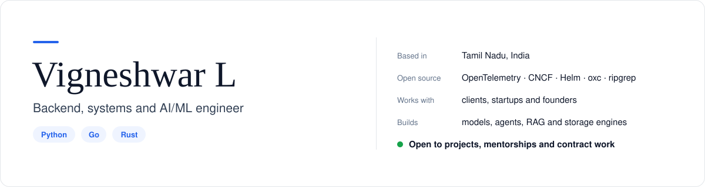
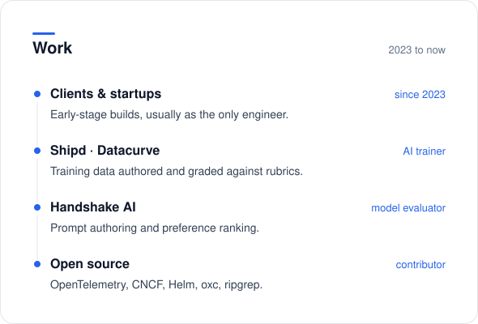
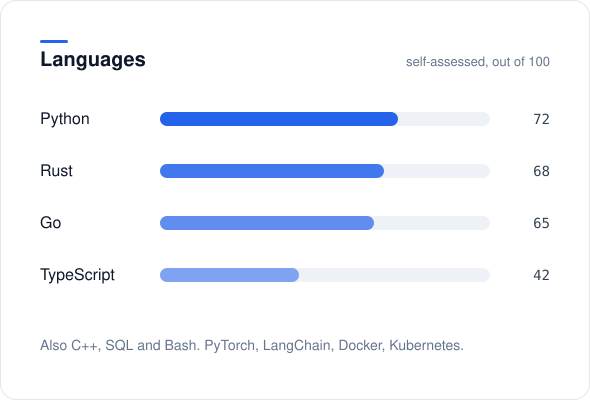
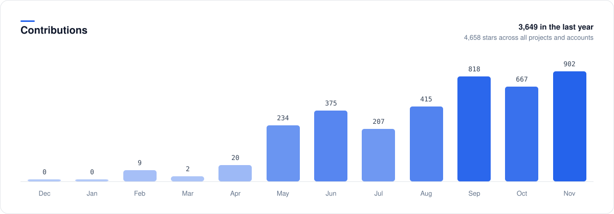

&nbsp;
&nbsp;
&nbsp;
&nbsp;

 

I build backend and systems software, and I help train the models that are starting to write it too. Most of my work has been for clients, early-stage startups and founders at the point where nothing exists yet and the first version has to actually work.

&nbsp;

<b>The long version</b>

 

**What I build.** Models, reinforcement learning environments, agents and RAG systems on one side. Storage engines, distributed systems and backend services on the other. The two halves inform each other more than people expect: knowing where latency really comes from makes you a better engineer of AI systems, not just a better backend developer.

**2023, starting.** I started B.Tech Computer Science in Tamil Nadu with very little idea what I was doing. The first programs I wrote barely ran. What changed things was realising that almost everything worth learning was already written down, in public, in other people's repositories. So I started reading them. I still do, most days.

**2024, going lower.** I got tired of not knowing what was underneath. C++ first, then Rust, which I picked because it refuses to let you stay vague about ownership and lifetimes. Learning it was slow and occasionally humiliating, and it taught me more about how machines actually work than the two years before it combined.

**2025, building the hard thing.** I wrote FluxDB, a time series database, from scratch in Rust, to find out where the cost really lives inside a storage engine: columnar compression, a write path worth benchmarking, a great deal of profiling. Then rustkvd, a distributed key value store with Raft, an LSM engine and MVCC, for the same reason applied to consensus.

**2026, models and agents.** I began working with Shipd (Datacurve) and Handshake AI, authoring training data and grading model output against detailed rubrics. Alongside that, agent systems, RL environments and retrieval pipelines for startups who needed them working, not demonstrated.

**Open source.** OpenTelemetry, CNCF, Helm, oxc, ripgrep. Working in codebases that size teaches one specific skill: reading unfamiliar code well enough to change it without breaking anything, then taking the review that follows seriously.

**Now.** Still building systems, still reading more code than I write. If you are hiring for backend, systems or cloud native work, or you have something early that needs building properly, the contact details are at the top of this page.

 

<picture>
  <source media="(prefers-color-scheme: dark)" srcset="https://raw.githubusercontent.com/vignesh2027/vignesh2027/snake-output/snake-mono-dark.svg">
  
</picture>
